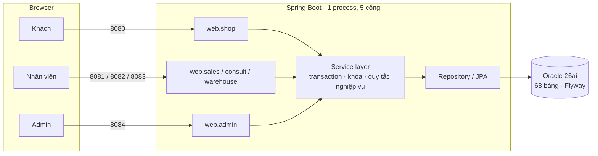

# Lapstore – Sàn bán laptop theo serial

Hệ thống quản lý và bán laptop cho cửa hàng/chuỗi nhỏ, bán **tại quầy** và **online**. Điểm khác với một web bán hàng thông thường: mỗi chiếc máy là một **serial (SN/IMEI)** riêng, nên hệ thống phải bảo đảm một máy không bao giờ bị bán cho hai người, giá trên đơn không bị "trôi" khi đổi giá sau đó, và voucher không bị dùng vượt hạn mức.


> **Tình trạng hiện tại:** giao diện (26 màn hình), schema CSDL (68 bảng), entity và các controller cơ bản đã xong. Tầng service (nghiệp vụ) **chưa cài đặt**, hiện được thay bằng stub nên các thao tác ghi sẽ báo "chưa sẵn sàng". Xem [Tiến độ & Danh sách công việc](#tiến-độ--danh-sách-công-việc).

---

## Mục lục

- [Bài toán nghiệp vụ](#bài-toán-nghiệp-vụ)
- [Tính năng](#tính-năng)
- [Kiến trúc](#kiến-trúc)
- [Công nghệ](#công-nghệ)
- [Bắt đầu nhanh](#bắt-đầu-nhanh)
- [Cấu trúc thư mục](#cấu-trúc-thư-mục)
- [Bản đồ route](#bản-đồ-route)
- [Quy tắc nghiệp vụ cốt lõi](#quy-tắc-nghiệp-vụ-cốt-lõi)
- [Tiến độ & Danh sách công việc](#tiến-độ--danh-sách-công-việc)
- [Tài liệu dự án](#tài-liệu-dự-án)
- [Quy ước làm việc nhóm](#quy-ước-làm-việc-nhóm)

---

## Bài toán nghiệp vụ

Cửa hàng bán laptop qua hai kênh:

- **Tại quầy:** nhân viên giữ đúng chiếc máy thật, thu tiền, xuất hóa đơn.
- **Online:** khách đặt trên web, cửa hàng xác nhận, gán serial thật rồi giao hoặc cho nhận tại shop.

Năm mục tiêu hệ thống phải đạt:

| # | Mục tiêu | Cách kiểm chứng |
|---|---|---|
| G1 | Không bán trùng serial | Không có hai đơn `COMPLETED` cùng `serial_id` |
| G2 | Giá đơn không đổi khi đổi giá sau đó | `order_item` lưu snapshot giá |
| G3 | Voucher không vượt hạn mức | `used + reserved ≤ total_limit` |
| G4 | Nhân viên chỉ làm đúng việc của mình | Phân quyền RBAC theo permission |
| G5 | Khách tự phục vụ cơ bản | Xem máy, đặt hàng, tra cứu đơn không cần đăng nhập |

## Tính năng

Hệ thống gồm **5 phân hệ**, mỗi phân hệ chạy ở một cổng riêng:

| Cổng | Phân hệ | Đối tượng | Đăng nhập | Chức năng chính |
|---|---|---|---|---|
| `8080` | **Shop** `/shop` | Khách | Không | Duyệt máy, giỏ hàng, checkout, tra cứu đơn, yêu cầu đổi trả |
| `8081` | **Sales** `/staff/sales` | Nhân viên bán hàng | Có | Bán quầy, giữ serial, xử lý đơn online, in hóa đơn |
| `8082` | **Consult** `/staff/consult` | Nhân viên tư vấn | Có | Chat với khách, hỗ trợ chọn máy |
| `8083` | **Warehouse** `/staff/warehouse` | Nhân viên kho/khuyến mãi | Có | Nhập kho, chuyển kho, campaign & voucher, đề xuất giá |
| `8084` | **Admin** `/admin` | Quản trị | Có | Quản lý user, xếp ca, duyệt giá, báo cáo doanh thu |

Một người có thể giữ nhiều vai trò. Quyền được kiểm tra theo permission chứ không chỉ theo tên vai trò.

## Kiến trúc

Ứng dụng là một **modular monolith**: một Spring Boot duy nhất, chia package theo module rõ ranh giới (không phải microservices). Một process mở nhiều cổng Tomcat, `PortGuardFilter` chặn các đường dẫn đi nhầm cổng.



**Luật phụ thuộc:** controller chỉ nằm ở `com.lapstore.web.<portal>`, chỉ gọi `*.service` và trả tên view. Controller và giao diện **không** gọi repository trực tiếp.

## Công nghệ

| Lớp | Công nghệ |
|---|---|
| Ngôn ngữ / Framework | Java 25, Spring Boot 4.1 (Web MVC, Data JPA, Security, Validation, Actuator, WebSocket, Mail) |
| Giao diện | Thymeleaf, Tailwind CSS 4 |
| CSDL | Oracle AI Database 26ai Free, Flyway |
| Xuất file | Apache POI (Excel), OpenPDF (hóa đơn PDF) |
| AI tư vấn | Spring AI 2.0 (Anthropic) |
| Kiểm thử | JUnit 5, Spring Boot Test, ArchUnit |
| Build | Maven Wrapper, npm (chỉ để build CSS) |

## Bắt đầu nhanh

### Yêu cầu

- JDK 25
- Docker (để chạy Oracle)
- Node.js 20+ (để build Tailwind CSS)

### 1. Chạy Oracle bằng Docker

```bash
docker run -d --name oracle26ai -p 1521:1521 \
  -e ORACLE_PWD='ChangeMe_123' \
  -v oracle26ai-data:/opt/oracle/oradata \
  container-registry.oracle.com/database/free:latest

docker logs -f oracle26ai   # đợi báo database sẵn sàng rồi Ctrl+C
```

### 2. Tạo PDB và user

Kết nối bằng `SYS` rồi chạy:

```sql
CREATE PLUGGABLE DATABASE LAPTOP
  ADMIN USER LAPTOP_ADMIN IDENTIFIED BY "<mat_khau_cua_ban>"
  FILE_NAME_CONVERT = ('/opt/oracle/oradata/FREE/pdbseed/', '/opt/oracle/oradata/FREE/laptop/');
ALTER PLUGGABLE DATABASE LAPTOP OPEN;
ALTER PLUGGABLE DATABASE LAPTOP SAVE STATE;

ALTER SESSION SET CONTAINER = LAPTOP;
CREATE TABLESPACE users DATAFILE '/opt/oracle/oradata/FREE/laptop/users01.dbf'
  SIZE 200M AUTOEXTEND ON NEXT 100M MAXSIZE UNLIMITED;
ALTER USER laptop_admin DEFAULT TABLESPACE users QUOTA UNLIMITED ON users;
GRANT CREATE SESSION, CREATE TABLE, CREATE SEQUENCE, CREATE VIEW,
      CREATE PROCEDURE, CREATE TRIGGER, CREATE TYPE TO laptop_admin;
```

> Gặp `ORA-01109: database not open` sau khi restart container? Mở lại PDB: `ALTER PLUGGABLE DATABASE LAPTOP OPEN;`

### 3. Cấu hình

Mật khẩu DB lấy từ biến môi trường, **không ghi cứng vào mã nguồn**:

```bash
export DB_PASSWORD='<mat_khau_cua_ban>'
# Chỉ cần khi dùng trợ lý AI (Spring AI - Anthropic):
export ANTHROPIC_API_KEY='<api_key>'
```

Các cấu hình chính nằm ở `src/main/resources/application.yml`: URL JDBC (`jdbc:oracle:thin:@//localhost:1521/LAPTOP`), danh sách cổng (`app.ports`) và thời gian giữ máy (`app.hold.*`).

### 4. Build CSS và chạy ứng dụng

```bash
npm install
npm run css:build        # hoặc `npm run css:watch` khi đang sửa giao diện

./mvnw spring-boot:run   # Windows: mvnw.cmd spring-boot:run
```

Flyway sẽ tự tạo 68 bảng từ `db/migration/V1__initial_schema.sql` ở lần chạy đầu. Hibernate chạy `ddl-auto: validate`, nghĩa là schema do Flyway quản lý, không phải Hibernate.

### 5. Mở ứng dụng

| Phân hệ | URL |
|---|---|
| Shop | http://localhost:8080/shop |
| Sales | http://localhost:8081/staff/login |
| Consult | http://localhost:8082/staff/login |
| Warehouse | http://localhost:8083/staff/login |
| Admin | http://localhost:8084/admin/login |
| Xem trước toàn bộ UI | http://localhost:8080/shop/_ui |

> Trang `/shop/_ui` cho xem nhanh các màn hình giao diện mà không cần service chạy thật, tiện cho việc làm frontend song song.

### Chạy kiểm thử

```bash
./mvnw verify
```

## Cấu trúc thư mục

```
laptop-store/
├── src/main/java/com/lapstore/
│   ├── web/            # Controller theo cổng: shop, sales, consult, warehouse, admin
│   ├── catalog/        # Hãng, sản phẩm, variant, thuộc tính, lịch sử giá
│   ├── inventory/      # Serial, tồn kho, giữ máy (stock_hold), nhập/chuyển kho
│   ├── sales/          # Giỏ, đơn, thanh toán, campaign, voucher
│   ├── aftersales/     # Đổi trả, bảo hành
│   ├── staff/          # User, role, permission, ca làm, chấm công
│   ├── chat/           # Phiên chat, tin nhắn, AI tool call
│   ├── reporting/      # Báo cáo ngày, audit, thông báo
│   ├── common/         # Exception, lock, tiện ích dùng chung
│   └── config/         # Security, chia cổng, PortGuardFilter, stub service
├── src/main/resources/
│   ├── templates/      # Thymeleaf: layout, shop, sales, consult, warehouse, admin, error
│   ├── static/         # css (output Tailwind), js
│   └── db/migration/   # Flyway: V1__initial_schema.sql
├── src/main/frontend/  # input.css – nguồn Tailwind
└── pom.xml
```

Mỗi module nghiệp vụ có cùng bố cục `domain/` (entity) · `dto/` · `repo/` · `service/`.

## Bản đồ route

Hiện có **53 route** trên 19 controller. Tóm tắt theo phân hệ (bản đầy đủ xem [`CONTROLLERS.md`](CONTROLLERS.md)):

| Phân hệ | Route chính |
|---|---|
| Shop | `GET /shop` · `GET /shop/products/{id}` · `/shop/cart` · `/shop/checkout` · `/shop/orders/lookup` · `/shop/returns` |
| Sales | `/staff/sales/counter` (mở / giữ / hoàn tất) · `/staff/sales/orders` (danh sách, chi tiết, gán serial, xác nhận, hoàn tất, hủy, hóa đơn PDF) |
| Consult | `/staff/consult` · `/staff/consult/sessions/{id}` (xem, gửi tin) |
| Warehouse | `/staff/warehouse/receipts` · `/transfers` · `/campaigns` · `/prices` |
| Admin | `/admin/users` · `/admin/shifts` · `/admin/prices` (duyệt / từ chối) · `/admin/reports` (+ xuất Excel) |

## Quy tắc nghiệp vụ cốt lõi

Đây là những quy tắc mà mọi đoạn code nghiệp vụ phải tuân theo. Danh sách đầy đủ ở [Tài liệu BA](docs/Tai_lieu_BA_Lapstore.html).

| Mã | Quy tắc |
|---|---|
| BR-01 | Mỗi `serial_number` là duy nhất trong toàn hệ thống |
| BR-02 | Chỉ bán serial ở trạng thái `IN_STOCK`. Việc "giữ" nằm ở `stock_hold`, không dùng trạng thái `RESERVED` trên serial |
| BR-03 | Tại một thời điểm, một serial chỉ có tối đa một hold `ACTIVE` |
| BR-04 | Hold có `expires_at`; job nền đánh dấu `EXPIRED` và nhả tài nguyên |
| BR-05 | Giá trên đơn là snapshot, không join lại bảng giá khi in lại hóa đơn |
| BR-06 | Chỉ giá `APPROVED` và đang hiệu lực mới được dùng để bán |
| BR-07 | `used_count + reserved_count ≤ total_limit` với mọi voucher có hạn mức |
| BR-08 | Tra cứu đơn online bắt buộc khớp **mã đơn + số điện thoại** |
| BR-09 | Nhân viên chỉ thao tác khi có permission tương ứng |
| BR-10 | Đơn quầy gắn chi nhánh và (nếu bật chính sách) ca làm của nhân viên |
| BR-11 | Hủy đơn hoặc hết hạn thì nhả hold, không để tồn "treo" |
| BR-12 | Đổi trả chỉ với đơn đủ điều kiện; serial cập nhật theo quyết định `RESTOCK` / `WARRANTY`... |

---

## Tiến độ & Danh sách công việc

Thứ tự bên dưới bám theo **12 bước dựng dự án** và thứ tự ưu tiên MVP trong tài liệu BA. Mục nào có dòng *"Xong khi…"* là điều kiện để tick.

**Phạm vi:** bước 1–9 và 11 là bắt buộc. Bước 10 (realtime, chat, AI) và phần hậu mãi là điểm cộng, nếu chậm tiến độ thì cắt các phần này trước, không cắt kiểm thử.

### Đã hoàn thành

- [x] Thiết kế tài liệu BA, tài liệu hệ thống, thiết kế CSDL 68 bảng, thiết kế 26 màn hình
- [x] Migration `V1__initial_schema.sql` (68 bảng, 7 module)
- [x] Entity JPA cho các module: catalog, inventory, sales, aftersales, staff, chat, reporting
- [x] Giao diện Thymeleaf + Tailwind cho 26 màn hình (2 layout, fragment alerts, 3 trang lỗi)
- [x] Trang xem trước giao diện `/shop/_ui`
- [x] 19 controller cơ bản, 53 route (shop, sales, consult, warehouse, admin)
- [x] Cấu hình bảo mật 3 chain: admin / staff / shop, mật khẩu BCrypt
- [x] Chia 5 cổng Tomcat + `PortGuardFilter`
- [x] Xử lý lỗi tập trung (`GlobalExceptionHandler`, `BusinessException`, `NotFoundException`)
- [x] Khai báo interface service và stub tạm (`ServiceNotReadyException`)

### Bước 1–2 · Môi trường & khung dự án

- [ ] Cả nhóm cài đúng môi trường: JDK 25, Docker, Oracle, user `laptop_admin`
  *Xong khi: `java -version` ra 25, kết nối được PDB `LAPTOP`.*
- [ ] Bỏ mật khẩu mặc định trong `application.yml`, bắt buộc đọc từ `DB_PASSWORD`
- [x] Thêm `ArchitectureTest` (ArchUnit) để khóa luật phụ thuộc controller -> service -> repo
- [ ] Viết `.env.example` / hướng dẫn biến môi trường cho thành viên mới

### Bước 3–4 · Nền tảng & bảo mật

- [ ] Xác nhận Flyway chạy sạch trên máy mọi thành viên
  *Xong khi: `flyway_schema_history` thành công, đủ bảng.*
- [x] Seed dữ liệu ban đầu: role, permission, chi nhánh, ca mẫu
- [x] `AdminBootstrap`: tự tạo tài khoản admin đầu tiên
- [x] `AppUserDetailsService`: nạp user và gán authority (`ADMIN_ACCESS`, `PORTAL_SALES`, `PORTAL_CONSULT`, `PORTAL_WAREHOUSE`)
  *Xong khi: đăng nhập admin vào được `/admin`; chưa đăng nhập vào `/staff` bị chuyển về trang login; `/shop` vào tự do.*
- [x] Redirect sau đăng nhập đúng theo cổng/vai trò

### Bước 5 · Danh mục & giá

- [x] Repository cho catalog: product, variant, price_history, tìm kiếm có phân trang (chưa làm thuộc tính, ảnh)
- [x] `CatalogService`: danh sách có lọc/phân trang, chi tiết sản phẩm, chọn variant (UC-C01)
- [x] `PriceHistoryService`: đề xuất giá `PENDING` -> duyệt -> đóng `effective_to` bản cũ (BR-06)
- [x] Từ chối đề xuất giá có khoảng hiệu lực chồng nhau
  *Xong khi: đổi giá tạo dòng `price_history` mới, dòng cũ có `effective_to`.*
- [x] Kết nối màn Duyệt giá (admin) và Đề xuất giá (warehouse)

### Bước 6 · Kho & serial

- [x] Repository cho inventory (serial, balance, hold, receipt, transfer)
- [x] `InventoryService.createReceipt` (chưa chạy thử với Oracle): phiếu nhập -> sinh `serial_item IN_STOCK`, cập nhật `inventory_balance`, từ chối trùng serial (BR-01)
  *Xong khi: nhập 5 serial -> `on_hand = 5`, `held_qty = 0`, có 5 dòng `serial_status_history`.*
- [x] `InventoryService.transfer` + `receiveTransfer`: `IN_TRANSIT` -> nhận tại chi nhánh đích -> `IN_STOCK` (chưa chạy thử; màn hình nhận hàng chưa có, mới có endpoint `POST /staff/warehouse/transfers/{code}/receive`)
- [ ] Nhập/xuất danh sách serial bằng Excel (Apache POI)
- [ ] Kiểm kê (`stocktake`)

### Bước 7 · Giữ máy tại quầy

- [x] `KeyedLock` trong `common/lock` (khóa theo `serial:ID`, bọc ngoài transaction)
- [x] `StockHoldService.hold` / `release` (BR-02, BR-03)
- [x] Ràng buộc unique "một hold ACTIVE cho một serial" ở mức DB
- [ ] Job `@Scheduled` hết hạn hold (BR-04, BR-11)
- [ ] Test tranh chấp: hai quầy cùng giữ một serial
  *Xong khi: đúng một luồng thành công, luồng còn lại nhận lỗi nghiệp vụ rõ ràng.*

### Bước 8 · Đơn hàng

- [ ] `CounterCheckoutService`: mở đơn quầy (mỗi nhân viên tối đa 1 đơn đang mở), thu tiền, hold -> `CONVERTED`, serial -> `SOLD`
- [ ] `CartService` và giỏ hàng khách (session)
- [ ] `OnlineOrderService`: checkout không cần đăng nhập, giữ số lượng, snapshot giá từng dòng
- [ ] `OrderService`: xác nhận · gán serial · hoàn tất · hủy (kèm lý do), ghi `order_status_history`
- [ ] `OrderQueryService`: danh sách đơn, chi tiết, tra cứu theo mã đơn + SĐT (BR-08)
- [ ] Hóa đơn PDF (`/staff/sales/orders/{id}/invoice.pdf`) bằng OpenPDF
- [ ] Test tranh chấp: nhiều đơn online cùng tranh vài máy cuối
  *Xong khi: đặt online 1 máy -> `held_qty` +1; nhân viên xác nhận và gán serial -> serial `SOLD`, lịch sử trạng thái đủ dòng.*

### Bước 9 · Khuyến mãi & voucher

- [ ] `CampaignService`: tạo campaign theo phạm vi sản phẩm/hãng, tạo voucher có hạn mức và thời hạn
- [ ] `PricingEngine`: tính giảm giá (Strategy + chuỗi xử lý)
- [ ] Giữ lượt voucher nguyên tử: reserve -> commit -> release (BR-07)
- [ ] Test tranh chấp: voucher giới hạn 3 lượt, 10 người dùng cùng lúc
  *Xong khi: đúng 3 người thành công.*

### Bước 10 · Realtime, chat, AI *(điểm cộng)*

- [ ] `ChatService`: phiên chat HUMAN, gửi/nhận tin nhắn
- [ ] WebSocket/STOMP cho chat và cập nhật "máy đang giữ" theo thời gian thực
- [ ] Trợ lý AI dùng tool calling (chỉ trả giá/tồn đọc từ DB, không tự bịa), ghi `ai_tool_call_log`
- [ ] Chuyển qua lại AI ↔ HUMAN

### Bước 11 · Nhân sự, báo cáo, thông báo

- [x] `StaffService`: tạo/khóa user, gán role, băm mật khẩu BCrypt (UC-A01)
- [x] Xếp ca, chặn trùng khung giờ (UC-A02) — hiện ném `BusinessException`, chưa có lớp `ShiftConflictException` riêng
- [ ] Chấm công; chưa chấm công thì không mở được đơn quầy (BR-10)
- [ ] `ReportingService`: báo cáo doanh thu/lãi ước tính theo ngày và chi nhánh, job tổng hợp `daily_sales_summary`
- [ ] Dashboard admin hiển thị KPI thật
- [ ] Xuất báo cáo Excel (`/admin/reports/export.xlsx`)
- [ ] Gửi email bất đồng bộ (`@Async`) và thông báo trong hệ thống, chỉ gửi sau commit

### Bước 12 · Hậu mãi, kiểm thử, hoàn thiện

- [ ] `AftersalesService`: tạo yêu cầu đổi trả (khớp mã đơn + SĐT + serial), cập nhật serial theo quyết định (BR-12)
- [ ] Bảo hành cơ bản (`warranty_claim`)
- [ ] Xử lý thủ công yêu cầu đổi trả ở phía nhân viên *(hiện chưa có màn hình)*
- [ ] Rà soát bảo mật: CSRF trên mọi form POST, không lộ dữ liệu đơn khác, kiểm tra quyền từng route
- [ ] `./mvnw verify` chạy xanh
- [ ] Chuẩn bị và chạy thử kịch bản demo

### Việc phát sinh / cải thiện thêm

- [x] Trang đăng nhập admin riêng (`admin-login.html`, AU-02), tách khỏi đăng nhập nhân viên
- [x] Sidebar theo từng phân hệ (mục con theo quyền, tô sáng mục đang xem) + khối "Chuyển phân hệ"
- [x] WH-05 Sản phẩm: bảng cấu hình kèm tồn kho (`/staff/warehouse/products`), sửa thông tin (`/{variantId}/edit`), quyền mới `PRODUCT_MANAGE` (migration V3). Giá vẫn đi qua đề xuất → duyệt (BR-06) *(chưa chạy thử)*
- [x] Nhập kho làm lại (WH-01): bỏ JSON; chọn hoặc tạo sản phẩm, tick màu/CPU/GPU (không bắt buộc)/RAM/ổ cứng từ danh mục để nhân tổ hợp biến thể (VD 2 màu × 3 RAM × 3 ổ cứng = 18 dòng); thuộc tính chọn từ danh sách, thêm mới có kiểm tra trùng, mỗi dòng có giá vốn, giá bán (biến thể mới) và serial. Tạo sản phẩm/biến thể và nhập serial trong một transaction. Biến thể mới ở trạng thái INACTIVE kèm đề xuất giá PENDING, admin duyệt xong tự mở bán *(chưa chạy thử)*
- [x] WH-06 Tồn kho theo chi nhánh (`/staff/warehouse/stock`) và danh sách serial từng cấu hình *(chưa chạy thử)*
- [x] WH-07 Thuộc tính (`/staff/warehouse/attributes`): quản lý CPU/GPU/RAM/ổ cứng trên bảng `attribute_definition` + `attribute_option` có sẵn (không thêm bảng, không migration): xem số sản phẩm/biến thể đang dùng, thêm (chống trùng), sửa tên CPU/GPU (cập nhật luôn sản phẩm đang dùng), xóa khi không còn sản phẩm nào dùng *(chưa chạy thử)*
- [x] WH-05b Chi tiết sản phẩm (`/staff/warehouse/products/{productId}`): thông tin chung, mọi biến thể kèm tồn kho; form sửa chọn CPU/GPU/RAM/ổ cứng từ danh sách *(chưa chạy thử)*
- [x] Giao diện nhân viên: bố cục động (Sidebar ↔ Top menu, thu gọn/mở sidebar, menu kéo trên điện thoại), nút ⚙ Cài đặt, ô "Tìm nhanh" thành tìm sản phẩm thật (chỉ phân hệ kho) *(chưa chạy thử trên trình duyệt)*
- [x] Hệ thống tab (iframe): mỗi trang một tab, giữ nguyên trạng thái khi chuyển tab (đang tick dở ở Nhập kho, sang Chuyển kho rồi quay lại vẫn còn), cảnh báo khi đóng tab có dữ liệu chưa lưu, "Đóng tất cả tab", tối đa 10 tab *(chưa chạy thử trên trình duyệt)*
- [x] Bảng đẹp hơn và phân trang 12 dòng (serial 15 dòng) cho mọi danh sách; tìm kiếm trong Thuộc tính; form nhập chia section
- [x] Migration V4: cho phép hai biến thể chỉ khác GPU (đổi ràng buộc unique, không thêm bảng/cột)
- [x] Xem danh sách sản phẩm/biến thể đang dùng một giá trị thuộc tính (`/staff/warehouse/attributes/{id}/usage`, bấm vào số ở màn Thuộc tính) *(chưa chạy thử)*
- [x] Nhận hàng chuyển kho: danh sách phiếu (`/staff/warehouse/transfers/list`, mặc định "đang vận chuyển") và chi tiết phiếu kèm nút "Đã nhận đủ hàng" (`/staff/warehouse/transfers/{code}`) *(chưa chạy thử)*
- [x] Tab chi tiết/sửa sản phẩm ghi rõ tên sản phẩm/SKU; điều hướng sang trang đã có tab khác thì gộp tab; nút thu gọn nằm trong sidebar; thanh tìm kiếm là kính lúp bấm mới mở; top menu căn lề theo nội dung, bỏ thanh cuộn ngang
- [ ] Danh sách phiếu nhập kho, ràng buộc chỉ chi nhánh đích mới được nhận hàng, upload ảnh sản phẩm, thêm màu/danh mục mới, màn nhận hàng chuyển kho, danh sách phiếu nhập/chuyển, nhập serial bằng Excel
- [ ] Đưa WH-05 và AU-02 vào `/shop/_ui` và tài liệu thiết kế UI (hiện thiết kế gốc chỉ có 26 màn, thiếu hai màn này)

- [ ] Gỡ stub trong `ServiceStubConfig` khi service tương ứng đã cài xong
- [ ] Bổ sung `LICENSE`
- [ ] Thiết lập CI (GitHub Actions: build + test)
- [ ] Ảnh chụp màn hình các phân hệ đưa vào README

## Tài liệu dự án

Thư mục `docs/` chứa bộ tài liệu thiết kế của dự án:

| Tài liệu | Nội dung | Dành cho |
|---|---|---|
| [Tài liệu BA](docs/Tai_lieu_BA_Lapstore.html) | Actor, use case, luồng nghiệp vụ, quy tắc, MVP | BA, PM, Tester |
| [Tài liệu hệ thống](docs/Tai_lieu_he_thong_Lapstore.html) | Kiến trúc, từng tiến trình kỹ thuật, 12 bước dựng, kiểm thử tranh chấp | Developer |
| [Thiết kế CSDL](docs/Thiet_ke_CSDL_Lapstore_68bang.html) | 68 bảng, quan hệ, ràng buộc | BA, Developer |
| [Thiết kế UI](docs/Thiet_ke_UI_26_man_hinh_Lapstore.html) | 26 màn hình, hướng dẫn frontend, ánh xạ file ↔ controller | Frontend, Tester |
| [Bản đồ route](CONTROLLERS.md) | Route ↔ controller | Developer |

## Quy ước làm việc nhóm

- **Một module, một người chịu trách nhiệm**, nhưng ai viết code thì người đó viết test cho phần của mình.
- **Nhánh:** `main` luôn chạy được. Làm việc trên `feature/<module>-<mô-tả>`, mở Pull Request và nhờ ít nhất một người xem trước khi merge.
- **Commit:** viết ngắn, nói rõ làm gì, ví dụ `feat(inventory): hold serial theo KeyedLock`, `fix(shop): lỗi phân trang`.
- **Schema:** không sửa file Flyway đã chạy. Muốn đổi bảng thì thêm file mới `V2__...`, `V3__...`.
- **Business rule nằm ở service**, không nhúng vào HTML hay controller.
- **Không commit** mật khẩu, API key hay file cấu hình riêng của máy cá nhân.
- Tên bảng, class, biến, API dùng tiếng Anh; thông báo hiển thị cho người dùng dùng tiếng Việt.

---

<sub>Lapstore · Spring Boot · Oracle · Thymeleaf · Tailwind CSS</sub>
